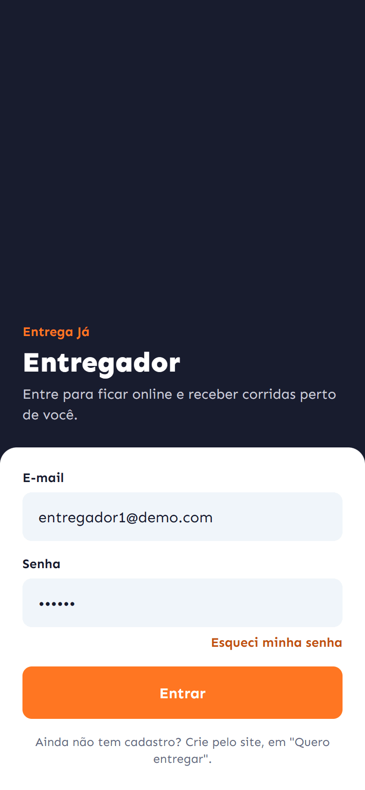
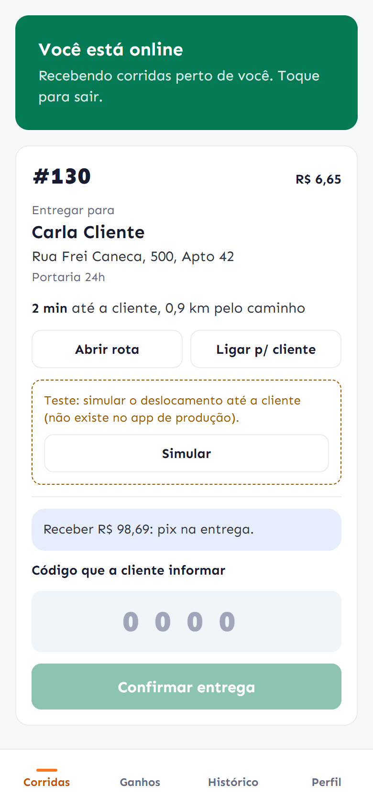
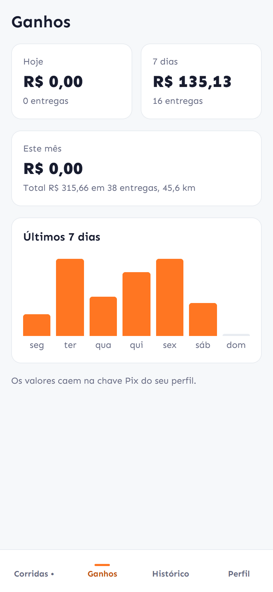
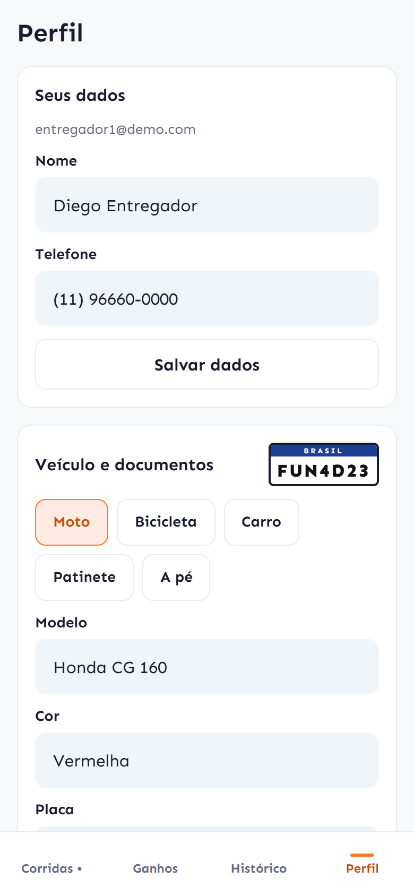

# Entrega Já · App do entregador

App nativo (Expo / React Native) para o entregador: ficar online, receber e aceitar corridas,
ir até a loja, confirmar a entrega com o código da cliente e acompanhar os ganhos.

Usa a mesma API do site (`entrega-ja-api`) e os mesmos tokens visuais (`entrega-ja-web`).

## Telas

| Entrar | Corrida em andamento | Ganhos | Perfil |
|---|---|---|---|
|  |  |  |  |

## Rodar

```bash
npm install
cp .env.example .env     # EXPO_PUBLIC_API_URL com o IP do computador na rede
npx expo start           # abra no Expo Go ou num build de desenvolvimento
```

No celular físico, a API precisa estar acessível pela rede: use `http://192.168.x.x:3000/api`,
não `localhost`. Notificações push e localização em segundo plano só funcionam num **build de
desenvolvimento** (`npx expo run:android` / `run:ios`) ou de produção (EAS); o Expo Go tem limites.

| Variável | Para quê |
|---|---|
| `EXPO_PUBLIC_API_URL` | Endereço da API |
| `EXPO_PUBLIC_DEMO_TOOLS` | `true` liga o simulador de deslocamento. Em desenvolvimento já vem ligado; **em produção, deixe vazio** |

## O que o app faz

- **Entrada:** login com e-mail e senha. "Esqueci minha senha" manda o link por e-mail; ele abre
  a página de nova senha no site e, depois, é só entrar no app com a senha nova.
- **Online salvo na conta:** o entregador escolhe ficar online uma vez. Ao abrir o app de novo
  (ou depois de uma queda de internet), volta online sozinho, até escolher ficar offline.
- **Localização em segundo plano:** continua enviando com a tela bloqueada ou com o Waze aberto.
  No Android aparece a notificação fixa "Você está online", exigência do sistema. Parado no
  lugar, um sinal a cada 30 s mantém o online.
- **Ofertas:** chegam pelo tempo real, com vibração, ou por push com o app fechado (canal
  `offers`, prioridade máxima). A oferta tem contagem regressiva, valor, distância até a loja e
  tempo do trajeto pelo melhor caminho.
- **Entrega:**
  - tempo e distância pelas ruas até a loja e depois até a cliente;
  - "Abrir rota" no Google Maps ou no Waze;
  - ligar para a loja ou para a cliente;
  - "Retirei o pedido" e confirmação pelo código de 4 dígitos;
  - aviso de troco quando o pagamento é em dinheiro.
- **Ganhos e histórico:** totais de hoje, 7 dias e mês, gráfico dos últimos dias, entregas
  paginadas.
- **Perfil:** dados pessoais, veículo (tipo, modelo, cor, placa no padrão Mercosul), CPF, CNH,
  chave Pix, senha e notificação de teste. O app mostra o que falta para ser aprovado.

## Organização

```
src/
  App.tsx            fontes, sessão e barra inferior (Corridas, Ganhos, Histórico, Perfil)
  config.ts          endereço da API e ferramentas de teste
  ds/                design system: tokens (theme.ts) e componentes
  lib/               api, armazenamento seguro, tempo real (SSE), push, localização, formatação
  features/          sessão (login) e turno (online, ofertas, posição)
  screens/           Entrar, Corridas, Ganhos, Histórico, Perfil
```

## Design system

`src/ds/theme.ts` tem os mesmos valores do site (laranja `#FF7622`, azul-marinho `#181C2E`,
fonte Sen, cantos 6/10/14/18), com modo escuro. Os componentes ficam em `src/ds/index.tsx`:

- texto: `T`;
- ações: `Button` (lg só para a ação única; botões lado a lado vão em `ButtonRow`, com a mesma largura), `Link`;
- superfícies: `Card`, `Alert`, `Badge`, `Plate`, `Stat`, `Empty`, `Divider`;
- formulário: `Field`, `SwitchRow`, `Choice`;
- tela: `Screen`, `Loading`.

## Ícone e marca

O ícone é o símbolo do site (a seta do "Entrega Já") em branco sobre o laranja da marca:

| Arquivo | Uso |
|---|---|
| `assets/icon.png` | ícone do app (1024 px, o iOS arredonda sozinho) |
| `assets/android-icon-foreground.png`, `-background.png`, `-monochrome.png` | ícone adaptativo do Android (o símbolo fica na zona segura central) |
| `assets/splash-icon.png` | tela de abertura, sobre o fundo `#FF7622` do `app.json` |
| `assets/notification-icon.png` | ícone das notificações e do serviço de localização no Android |
| `assets/favicon.png` | versão web |

Os ícones do site (`entrega-ja-web/public`) usam o mesmo desenho.

## Ferramenta de teste

O simulador de deslocamento ("Simular" no cartão da entrega) leva o entregador até a loja ou a
cliente sem sair do lugar. Ele só aparece com `__DEV__` ou `EXPO_PUBLIC_DEMO_TOOLS=true`; no
build de produção o botão não existe e a função não faz nada.

## CI

O workflow `CI` roda a checagem de tipos e o export web a cada push e pull request.

## Publicar

Use o EAS: `eas build` (precisa do `projectId` em `app.json` para o push) e defina
`EXPO_PUBLIC_API_URL` no perfil de produção do `eas.json`.
